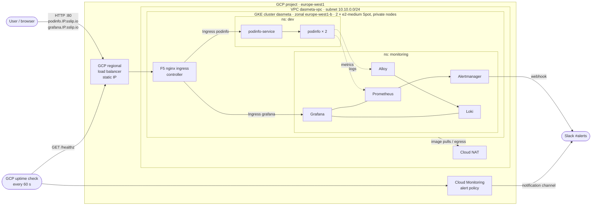

# podinfo on GKE

Infrastructure and platform code for running [podinfo](https://github.com/stefanprodan/podinfo), a small Go web app, on a private GKE cluster in GCP. It includes ingress, metrics, logs, alerting to Slack, an external health check and GitHub Actions CI/CD.

Everything is defined as code:
- **Terraform** creates the GCP infrastructure and installs the platform components as Helm releases.
- A **local Helm chart** deploys the application, its dashboard and its alert rules.
- **GitHub Actions** checks, deploys and tears down the whole environment.

---

## Contents

- [Architecture](#architecture)
- [Repository layout](#repository-layout)
- [Prerequisites](#prerequisites)
- [Deployment](#deployment)
- [Domain and health check](#domain-and-health-check)
- [Monitoring and alerting](#monitoring-and-alerting)
- [Load test results](#load-test-results)
- [Limitations](#limitations)
- [Cleanup](#cleanup)

---

## Architecture



**Request path:** client → regional LB on a reserved static IP → nginx ingress controller → Ingress rule (matched by host name) → ClusterIP Service → podinfo pods on port 9898.

| Layer | What | Where |
|---|---|---|
| **Network** | Custom VPC and subnet with secondary ranges for pods (`10.20.0.0/16`) and services (`10.30.0.0/20`); Cloud Router + Cloud NAT so private nodes can reach the internet; reserved regional static IP for the ingress | `terraform/infra/network` |
| **Compute** | VPC-native, zonal GKE cluster with private nodes (public control-plane endpoint); one node pool of **2 × e2-medium Spot** nodes | `terraform/infra/compute` |
| **External check** | Cloud Monitoring uptime check on `/healthz` + alert policy → Slack notification channel | `terraform/infra/uptime.tf` |
| **Ingress** | F5 NGINX Ingress Controller (`nginx/kubernetes-ingress`), `LoadBalancer` Service bound to the static IP, IngressClass `nginx` | `terraform/platform/nginx.tf` |
| **Application** | podinfo Deployment (2 replicas, liveness/readiness probes), Service, Ingress, Grafana dashboard, PrometheusRule | `k8s/charts/podinfo` |
| **Metrics** | kube-prometheus-stack: Prometheus, Alertmanager, Grafana, kube-state-metrics, node-exporter | `terraform/platform/monitoring.tf` |
| **Logs** | Grafana Alloy (collects pod logs via the Kubernetes API) → Loki (single binary, filesystem storage) | `terraform/platform/monitoring.tf` |

Terraform is split into **two root modules with separate state**:

| Module | Creates | State (GCS bucket `dasmeta-test`) |
|---|---|---|
| `terraform/infra` | VPC, subnet, NAT, static IP, GKE cluster and node pool, uptime check | prefix `infra/gcp` |
| `terraform/platform` | Helm releases: nginx, kube-prometheus-stack, Loki, Alloy, podinfo | prefix `platform/gcp` |

`platform` reads `infra`'s outputs (static IP, base domain) through `terraform_remote_state`. **`infra` must always be applied first and destroyed last.**

---

## Repository layout

```
.
├── .github/workflows/
│   ├── ci.yaml            # fmt, validate, helm lint/template: on PRs and pushes to main
│   ├── cd.yaml            # infra → platform apply: after CI succeeds on main, or manually
│   └── destroy.yaml       # platform → infra destroy: manual, requires typing "destroy"
├── k8s/charts/podinfo/    # application Helm chart
│   ├── values.yaml        # replicas, image, port, ingress host, alert thresholds
│   └── templates/         # deployment, service, ingress, dashboard (ConfigMap), alerts (PrometheusRule)
├── terraform/
│   ├── infra/             # GCP infrastructure (modules: network/, compute/)
│   └── platform/          # Helm releases + values/ (kube-prometheus-stack, loki, alloy)
└── load-test/             # k6 load test, runner script, report and results
```

---

## Prerequisites

### Tools (for local work)

| Tool | Version used | Purpose |
|---|---|---|
| Terraform | ≥ 1.9 (CI uses 1.15.6) | infra and platform |
| gcloud CLI + `gke-gcloud-auth-plugin` | latest | auth, cluster credentials |
| kubectl | matching the cluster (1.36) | cluster access |
| Helm | 3.x | chart lint / template |
| k6 | ≥ 1.0 | load test (optional) |
| jq | any | load test result parsing (optional) |

### One-time GCP setup (not managed by this repo)

1. **GCP project** `dasmeta-task` with billing enabled, and these APIs enabled: Compute Engine, Kubernetes Engine, Cloud Monitoring, Cloud Storage.
2. **GCS bucket** `dasmeta-test` for Terraform state (versioning recommended).
3. **Slack incoming webhook** for the alerts channel (`#alerts`).
4. **Cloud Monitoring notification channel** of type Slack with the display name **`alerts`**. `uptime.tf` looks it up by that exact name.
5. **Deployment service account** with a JSON key and permission to manage GKE, Compute networking/addresses, Cloud Monitoring, the state bucket, and to act as the node service account. For example: *Kubernetes Engine Admin*, *Compute Admin*, *Monitoring Editor*, *Service Account User*, and *Storage Object Admin* on the bucket.

### GitHub repository secrets

| Secret | Value |
|---|---|
| `GCP_SA_KEY` | JSON key of the deployment service account |
| `SLACK_WEBHOOK_URL` | Slack incoming webhook URL (used by Alertmanager) |

Never commit the key or the webhook. Locally, pass the webhook as `TF_VAR_slack_webhook_url`.

### Configuration

| File | Setting |
|---|---|
| `terraform/infra/terraform.tfvars` | `project_id`, `region`, `zone` (the zone must be in the region; validated) |
| `terraform/platform/terraform.tfvars` | `kube_context` and pinned chart versions: nginx-ingress `2.8.0`, kube-prometheus-stack `92.17.1`, loki `7.5.0`, alloy `1.15.0` |
| `k8s/charts/podinfo/values.yaml` | replicas, image tag, alert thresholds. `ingress.host` is overridden by Terraform |

If you change anything in the local chart, **bump `version` in `Chart.yaml`**. The Terraform Helm provider uses the chart version to detect changes.

---

## Deployment

### Option A: GitHub Actions (normal path)

| Workflow | Trigger | Does |
|---|---|---|
| **CI** | PR, push to `main`, manual | `terraform fmt -check`, `terraform validate` (both modules, no backend), `helm lint` + `helm template` |
| **CD** | CI completes successfully on `main`, or manual | Job 1: `terraform/infra` init → plan → apply. Job 2: fetch GKE credentials, then `terraform/platform` init → plan → apply |

- CD deploys the exact commit CI tested.
- CD and Destroy share a concurrency group, so only one runs at a time and a running apply is never cancelled.
- To push without triggering workflows, include `[skip ci]` in the commit message.
- A full deploy from scratch takes about 15–20 minutes, most of it cluster creation.

### Option B: locally

```bash
# 1. Authenticate (user credentials for Terraform)
gcloud auth login
gcloud auth application-default login
gcloud config set project dasmeta-task

# 2. Infrastructure
cd terraform/infra
terraform init
terraform apply

# 3. Cluster credentials (context name must match kube_context in platform tfvars)
gcloud container clusters get-credentials dasmeta --zone europe-west1-b --project dasmeta-task

# 4. Platform
cd ../platform
export TF_VAR_slack_webhook_url='https://hooks.slack.com/services/...'
terraform init
terraform apply
```

### Verify

```bash
terraform -chdir=terraform/infra output        # ingress_ip, base_domain, podinfo_url, grafana_url
kubectl get pods -n dev                        # 2 × podinfo Running, 1/1 Ready
kubectl get pods -n ingress-nginx
kubectl get pods -n monitoring
curl http://podinfo.<ingress_ip>.sslip.io/          # JSON with hostname / version
curl http://podinfo.<ingress_ip>.sslip.io/healthz   # {"status":"OK"}
```

---

## Domain and health check

### Domain (sslip.io)

There is no registered domain or DNS zone. Host names use **[sslip.io](https://sslip.io)**, a public wildcard DNS service that resolves any name containing an IP address to that IP:

```
podinfo.34.53.234.225.sslip.io  →  34.53.234.225
```

How it's wired:
1. `terraform/infra` reserves the static IP (`google_compute_address.ingress`, name `nginx-ingress-ip`).
2. It builds `base_domain = "<ip>.sslip.io"` in a local value and exports it, together with `podinfo_url` and `grafana_url`.
3. `terraform/platform` reads `base_domain` from remote state, binds the nginx LoadBalancer Service to the static IP, and sets the Ingress hosts:
   - `podinfo.<base_domain>` → podinfo
   - `grafana.<base_domain>` → Grafana

The F5 controller needs a `host` on every Ingress rule; that's why host-based names are used instead of a bare IP.

**Using a real domain:** create an `A` record (or a wildcard `*.example.com`) pointing to the static IP and change `base_domain` in `terraform/infra/outputs.tf`. Nothing else needs to change.

> The static IP is reserved for as long as the infrastructure exists. If the infrastructure is destroyed and recreated, a new IP is allocated and all URLs change.

### Health checks

| Check | From | Endpoint | Purpose |
|---|---|---|---|
| Liveness probe | kubelet | `/healthz` (delay 5 s, every 10 s) | restart the container if the process hangs |
| Readiness probe | kubelet | `/readyz` (delay 3 s, every 5 s) | send traffic only to ready pods |
| **External uptime check** | Google probers in several regions | `http://podinfo.<base_domain>/healthz` on port 80, every 60 s, 10 s timeout | verifies the whole public path: DNS → LB → ingress → Service → pod |

**Alert policy** `podinfo is down (external check)`: fires when the check fails from **more than one region for 2 minutes**. Requiring more than one region avoids alerts caused by one prober's network. It notifies the Cloud Monitoring channel `alerts` (Slack).

Because this check runs **outside** the cluster, it still alerts when the cluster, ingress or the whole monitoring stack is down. In-cluster Prometheus can't detect those cases.

---

## Monitoring and alerting

### Access Grafana

```bash
terraform -chdir=terraform/infra output -raw grafana_url    # http://grafana.<ip>.sslip.io
# user: admin, password is generated at install time:
kubectl get secret -n monitoring kube-prometheus-stack-grafana \
  -o jsonpath='{.data.admin-password}' | base64 -d; echo
```

### Metrics

- **Prometheus** (kube-prometheus-stack) scrapes kubelet/cAdvisor (container CPU and memory), kube-state-metrics and node-exporter.
  - Retention: 2 days.
  - Prometheus discovers ServiceMonitors, PodMonitors and PrometheusRules **in all namespaces, regardless of labels**.
- Control-plane components that GKE manages and doesn't expose are not scraped: controller-manager, scheduler, etcd, kube-proxy.
- The chart's default rule set is disabled. Only the rules below are loaded.

### Logs

- **Alloy** (1 replica) discovers pods through the Kubernetes API and reads their logs with `loki.source.kubernetes`. It attaches the labels `namespace`, `pod`, `container` and `app`, and pushes the logs to Loki.
- **Loki** runs in single-binary mode, stores data on a 5 Gi persistent disk, and keeps **72 h** of logs (the compactor deletes older data).
- Loki is added to Grafana as a data source (uid `loki`).

Example queries in Grafana → Explore → Loki:
```logql
{namespace="dev", app="podinfo"}
{namespace="ingress-nginx"} |= " 50"
```

### Dashboard

The podinfo chart ships a dashboard as a ConfigMap labelled `grafana_dashboard: "1"`. Grafana's sidecar picks it up from any namespace. It's at **Dashboards → podinfo** (`/d/podinfo`) and has three panels:

| Panel | Query |
|---|---|
| CPU usage per pod | `rate(container_cpu_usage_seconds_total{namespace="dev",container="podinfo"}[5m])` |
| Memory usage per pod | `container_memory_working_set_bytes{namespace="dev",container="podinfo"}` |
| Application logs | `{namespace="dev", app="podinfo"}` |

The standard kube-prometheus-stack dashboards (nodes, pods, workloads) are also available.

### Alert rules

| Alert | Condition | For | Defined in |
|---|---|---|---|
| `PodinfoHighCPU` | pod CPU > **0.2 cores** | 5 m | `k8s/charts/podinfo/templates/alerts.yaml` (threshold in `values.yaml`) |
| `PodinfoHighMemory` | pod working set > **100 MiB** | 5 m | same |
| `NodeHighCPU` | node CPU > **80%** | 10 m | `terraform/platform/values/kube-prometheus-stack.yaml` |
| `NodeHighMemory` | node memory used > **85%** | 10 m | same |
| podinfo is down (external check) | uptime check failing in > 1 region | 2 m | `terraform/infra/uptime.tf` |

### Routing to Slack

```
Prometheus rules ──► Alertmanager ──► Slack webhook ──► #alerts
GCP uptime check ──► Cloud Monitoring alert policy ──► notification channel "alerts" ──► #alerts
```

- **Alertmanager** groups alerts by `alertname` + `namespace`. It waits 30 s before sending a group, sends updates every 5 min, repeats every 4 h while an alert keeps firing, and also sends a message when an alert resolves.
- The webhook URL is passed to Helm with `set_sensitive` from `var.slack_webhook_url`, so it never appears in values files or plan output.
- The `Watchdog` alert (which always fires, to show the alerting pipeline is alive) goes to the `"null"` receiver and is not sent to Slack.

**Test the Slack route:**
```bash
kubectl -n monitoring port-forward svc/kube-prometheus-stack-alertmanager 9093 &
curl -XPOST localhost:9093/api/v2/alerts -H 'Content-Type: application/json' \
  -d '[{"labels":{"alertname":"TestAlert","namespace":"dev","severity":"warning"},"annotations":{"summary":"test"}}]'
```

---

## Load test results

A basic stepped load test was run with **k6** from a single client outside GCP (~70 ms network round trip to `europe-west1`).
- Request: `GET /` through the public ingress.
- Concurrency: 1 → 200 users, 30 s per step, no think time.
- Pass criteria: < 1% errors, p95 < 500 ms.

Full report: [`load-test/REPORT.md`](load-test/REPORT.md). How to run it: see [`load-test/run.sh`](load-test/run.sh).

| Concurrent users | RPS | p50 | p95 | p99 | Errors |
|---:|---:|---:|---:|---:|---:|
| 1 | 14.5 | 67 ms | 72 ms | 83 ms | 0% |
| 10 | 134 | 69 ms | 75 ms | 91 ms | 0% |
| 50 | 699 | 70 ms | 80 ms | 91 ms | 0% |
| 100 | 1,296 | 73 ms | 99 ms | 118 ms | 0% |
| 200 | 2,256 | 80 ms | 129 ms | 207 ms | 0% |

- **0 errors across ~145k requests.** The pass criteria held at every level.
- **Performance starts to get worse at ~100 concurrent users (~1,300 RPS).** Tail latency rises and throughput stops scaling linearly. The breaking point was not reached.
- **The bottleneck is the node that receives ingress traffic, not the application.**
  - The nginx controller is a single replica, and its Service uses `externalTrafficPolicy: Local`, so all traffic enters through one node. That node went above its allocatable CPU from 50 users.
  - Per-request access logging, shipped by both GKE's logging agent and Alloy, used more CPU than nginx itself.
  - The podinfo pods together used ~0.3 CPU.

```bash
./load-test/run.sh                                   # default steps
STEPS="200 400 800" DURATION=60 ./load-test/run.sh   # push further
```

---

## Limitations

This is a small, cost-optimised environment. Known gaps:

| Area | Limitation | Production approach |
|---|---|---|
| **TLS** | HTTP only, no certificates | cert-manager + Let's Encrypt, or Google-managed certificates; redirect HTTP → HTTPS |
| **Domain** | Depends on the public sslip.io service, and the IP changes when the infrastructure is recreated | Owned domain, Cloud DNS managed by Terraform |
| **CI/CD auth** | Long-lived service account JSON key in GitHub Secrets | Workload Identity Federation (OIDC), no stored keys |
| **Node identity** | Nodes use the default Compute service account with the `cloud-platform` scope | Dedicated least-privilege node SA, GKE Workload Identity for pods |
| **Availability** | Zonal cluster, 2 Spot nodes, which can be preempted at any time with little warning. A single nginx replica is a single point of failure | Regional cluster, on-demand or mixed node pools, 2+ ingress replicas with anti-affinity and PodDisruptionBudgets |
| **Capacity** | e2-medium is a shared-core, burstable machine. podinfo has no resource requests/limits and no HPA. No cluster autoscaler | Non-shared-core nodes, requests/limits on all workloads, HPA, cluster autoscaler |
| **Monitoring storage** | Prometheus (2 d retention) and Alertmanager have no persistent volumes, so data is lost on pod restart. Loki is a single replica on a local disk | Persistent volumes or managed Prometheus; Loki on object storage (GCS) |
| **Grafana** | Admin password is generated at install time and stored only in a Kubernetes secret; no SSO | Password from Secret Manager, or Google OAuth/SSO |
| **App metrics** | Only container-level CPU/memory. podinfo's own `/metrics` (request rate, latency) is not scraped | ServiceMonitor for podinfo and RED dashboards (rate, errors, duration) |
| **Logging cost** | Container logs are shipped twice: by GKE's Cloud Logging agent and by Alloy to Loki | Choose one pipeline (limit GKE logging to system components) |
| **CI** | No `terraform plan` on pull requests, no security or policy scanning, no Kubernetes schema validation | Plan as a PR comment, tflint, checkov/trivy, kubeconform |
| **Config** | Project, cluster name and zone are hard-coded in workflows and tfvars; there is one environment (`dev`) | Per-environment tfvars or workspaces, variables in workflows |

---

## Cleanup

Destroy in **reverse order of creation**: platform first, then infrastructure. Removing the platform deletes the nginx `LoadBalancer` Service, which releases the static IP so the infrastructure can be deleted.

### Option A: GitHub Actions

**Actions → Destroy → Run workflow** and type `destroy` in the confirmation field.

It runs:
1. **destroy-platform:** `terraform destroy` on `terraform/platform`, then deletes the persistent volume claims in `monitoring` (Loki's disk) and waits for the disks to be removed.
2. **destroy-infra:** waits (up to 5 min) until no GCP forwarding rule uses the static IP, then runs `terraform destroy` on `terraform/infra`.

### Option B: locally

```bash
cd terraform/platform
terraform destroy

kubectl delete pvc --all -n monitoring --wait=true
# wait until the LB is gone (should print nothing):
gcloud compute forwarding-rules list --filter="IPAddress=$(terraform -chdir=../infra output -raw ingress_ip)"

cd ../infra
terraform destroy
```

### Check that nothing is left

```bash
gcloud container clusters list --project dasmeta-task
gcloud compute addresses list  --project dasmeta-task
gcloud compute disks list      --project dasmeta-task      # leftover PVC disks cost money
gcloud compute forwarding-rules list --project dasmeta-task
```

### Not removed by the destroy

These are prerequisites, not managed by this repo. Delete them manually if the project itself is being retired:
- the state bucket `dasmeta-test`
- the deployment service account and its key
- the Cloud Monitoring notification channel `alerts`
- the Slack webhook
- the GitHub secrets
