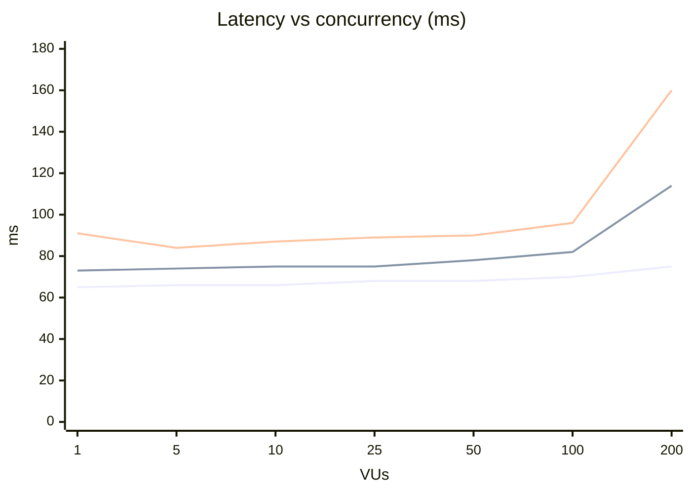

# Load test report: podinfo on GKE

**Run:** `load-test/results/20261105-172726` · 2026-11-05 17:27–17:32
**Tool:** k6, run by [`run.sh`](run.sh) with [`podinfo.js`](podinfo.js)
**Target:** `GET /` on `http://podinfo.<ip>.sslip.io`, which goes through the regional LB, then the nginx ingress controller (1 replica), then the podinfo Service (2 replicas)
**Cluster:** zonal GKE, 2 × e2-medium Spot nodes (2 shared vCPU, ~940m allocatable each)
**Load model:** closed model with a fixed number of VUs, no think time, and 30 s per step with 10 s cool-down. Steps were 1 → 5 → 10 → 25 → 50 → 100 → 200 VUs.
**Pass criteria (k6 thresholds):** `http_req_failed < 1%` and `p95 < 500 ms`

---

## 1. Summary

| | |
|---|---|
| **Result** | **Passed at every step.** All 154,792 requests returned 200: 0 failed requests and 0 failed checks. |
| **Peak throughput** | **2,441 RPS** at 200 VUs, with p95 at 114 ms and p99 at 160 ms. |
| **Knee** | Between **100 and 200 VUs (~1,400–2,400 RPS)**. Up to 100 VUs the extra latency added by the server stays under 20 ms at p95. At 200 VUs it is 51 ms at p95 and 97 ms at p99. |
| **Breaking point** | **Not reached.** p95 stayed well under 4× the 500 ms limit. |
| **Bottleneck** | One worker node (`…-0h3r`) used **1,184m CPU, 125% of allocatable**. The podinfo and nginx pods on it used only ~0.4 cores. The application itself is not the bottleneck. |
| **Biggest caveat** | Most of the measured latency (~63 ms) is the network round trip from the k6 client to `europe-west1`. The client ran outside GCP. |

---

## 2. Results

### 2.1 Client-side (k6)

| VUs | Requests | RPS | avg | p50 | p90 | p95 | p99 | max | Errors |
|---:|---:|---:|---:|---:|---:|---:|---:|---:|---:|
| 1 | 446 | 14.9 | 67 ms | 65 ms | 69 ms | 73 ms | 91 ms | 287 ms | 0% |
| 5 | 2,210 | 73.6 | 68 ms | 66 ms | 72 ms | 74 ms | 84 ms | 122 ms | 0% |
| 10 | 4,405 | 146.6 | 68 ms | 66 ms | 71 ms | 75 ms | 87 ms | 355 ms | 0% |
| 25 | 10,850 | 360.9 | 69 ms | 68 ms | 73 ms | 75 ms | 89 ms | 129 ms | 0% |
| 50 | 21,507 | 715.0 | 69 ms | 68 ms | 74 ms | 78 ms | 90 ms | 341 ms | 0% |
| 100 | 41,946 | 1,395.0 | 71 ms | 70 ms | 77 ms | 82 ms | 96 ms | 342 ms | 0% |
| **200** | **73,428** | **2,441.3** | **81 ms** | **75 ms** | **97 ms** | **114 ms** | **160 ms** | **538 ms** | **0%** |



### 2.2 Latency added by the server

`min` latency was **~63 ms at every step** (62.6–63.7 ms). That is the network round-trip floor between the client and the cluster. Subtracting it from each percentile gives an estimate of the time spent in the LB, nginx and podinfo, including any queueing:

| VUs | p50 − min | p95 − min | p99 − min |
|---:|---:|---:|---:|
| 1 | 1 ms | 9 ms | 27 ms |
| 10 | 3 ms | 12 ms | 24 ms |
| 50 | 6 ms | 15 ms | 28 ms |
| 100 | 7 ms | 20 ms | 34 ms |
| **200** | **12 ms** | **51 ms** | **97 ms** |

From 100 to 200 VUs, the time added by the server at p95 grows about **2.5×** and at p99 about **3×**. Queueing has started.

### 2.3 Throughput scaling

In a closed model, throughput is VUs ÷ latency (Little's law). The measured RPS matches that within 2% at every step, so k6 itself was not limiting throughput. The useful number is **RPS per VU**, which drops when each request takes longer:

| VUs | 1 | 5 | 10 | 25 | 50 | 100 | 200 |
|---|---:|---:|---:|---:|---:|---:|---:|
| RPS / VU | 14.9 | 14.7 | 14.7 | 14.4 | 14.3 | 13.9 | **12.2** |
| Scaling vs 1 VU | 100% | 99% | 98% | 97% | 96% | 94% | **82%** |

Throughput grows almost linearly up to 100 VUs. At 200 VUs, 18% of the ideal throughput is lost to the extra latency.

### 2.4 Resource usage (`kubectl top`, one sample ~22 s into each step)

| VUs | podinfo `grb9s` | podinfo `v9hfn` | nginx | Node `0h3r` | Node `x8mx` |
|---:|---:|---:|---:|---:|---:|
| 1 | 1m / 18Mi | 1m / 21Mi | 2m / 26Mi | 220m (23%) | 304m (32%) |
| 5 | 5m / 18Mi | 3m / 21Mi | 11m / 27Mi | 382m (40%) | 305m (32%) |
| 10 | 12m / 26Mi | 16m / 29Mi | 17m / 27Mi | 392m (41%) | 298m (31%) |
| 25 | 24m / 26Mi | 31m / 30Mi | 23m / 27Mi | 478m (50%) | 344m (36%) |
| 50 | 64m / 27Mi | 55m / 31Mi | 66m / 28Mi | **930m (98%)** | 444m (47%) |
| 100 | 99m / 28Mi | 83m / 31Mi | 74m / 27Mi | **1015m (107%)** | 469m (49%) |
| 200 | 144m / 28Mi | 113m / 31Mi | 132m / 28Mi | **1184m (125%)** | 622m (66%) |

*Node percentages are relative to allocatable CPU, not to the full 2 vCPU.*

---

## 3. Observations

### 3.1 The application has a lot of headroom
- The two podinfo pods together used **~0.26 cores at 2,441 RPS**, about 0.1 core per 1,000 RPS. Memory stayed flat at 28–31 Mi per pod. There is no sign of leaks or GC pressure.
- nginx used **~0.13 cores and 28 Mi** at peak, about 0.05 core per 1,000 RPS.
- On CPU alone, the current two pods could handle roughly 10× more traffic before they become the limit.

### 3.2 One node takes most of the load
- From 1 to 200 VUs, node `0h3r` gained **~960m CPU** and node `x8mx` gained **~320m**. The podinfo and nginx pods together account for only **~390m** of that ~1.28 cores. The rest is used by things `kubectl top` did not sample:
  - kernel network processing (softirq, conntrack, iptables/kube-proxy), which is not attributed to any pod;
  - log shipping. Every request writes an nginx access-log line, which both the GKE logging agent and Alloy collect and ship;
  - Prometheus, node-exporter and the other pods on that node.
- `0h3r` is very likely the node running the nginx controller. The F5 nginx-ingress chart's Service uses `externalTrafficPolicy: Local`, so the LB sends **all** traffic to the node that runs the single nginx replica. The other node only sees the traffic nginx forwards to the podinfo pod on it.
- `0h3r` was **above its allocatable CPU from 50 VUs**. On e2-medium this is possible only because shared-core machines can **burst** to 2 vCPU. The sustained baseline is 1 vCPU (50% × 2). A 30 s step is short enough to run entirely on burst credits, so **sustained capacity is probably lower than this test shows**.
- When a node is above allocatable, other pods on it are starved too, including probes, kubelet, metrics and log agents. On a busy shared node, that is often the first thing that breaks.

### 3.3 Latency
- About 90% of the latency at low load is network round trip, not the service.
- Until 100 VUs, the p99 − p50 gap stayed at ~20–25 ms. At 200 VUs it grew to **85 ms**: the tail widens before the median moves.
- Each step has a few single outliers of 290–540 ms in `max`, even at 1 VU. They are isolated: p99 at 1–100 VUs never exceeded 96 ms. They are most likely internet jitter or retransmits, not server stalls. The client's location makes this impossible to confirm.
- `http_req_blocked` / `http_req_connecting` max values of 65–360 ms are one-off TCP connects at the start of each step. Keep-alive was reused after that (p99 blocked ≈ 0).

### 3.4 Pod load split
- The `grb9s` pod used 20–30% more CPU than `v9hfn` at 100–200 VUs. Possible causes are a sampling artefact, uneven upstream keep-alive connections from nginx, or a noisy neighbour on that node. It is not big enough to matter at this load, but it is worth checking with per-pod request rates once podinfo's `/metrics` is scraped.

### 3.5 Run artefacts
- All `k6-*.log` files are **empty**. That is expected with `--quiet`, and it confirms k6 printed no warnings or errors. It also means the run records nothing about the client (k6 version, client host, start time per step).
- `kubectl top` takes **one sample per step**, using metrics-server's ~15–60 s window. The values in 2.4 are approximate.
- These numbers are slightly better than the table currently in the root `README.md` (for example, p99 at 200 VUs is 160 ms here vs 207 ms). The README table appears to come from an earlier run and should be updated to match this one.

---

## 4. Conclusions

1. With 2 replicas, podinfo handles **~2,400 RPS of `GET /` with 0 errors and p95 ≈ 114 ms** as seen from a remote client. The time added by the server stays under ~20 ms at p95 up to ~1,400 RPS.
2. The **practical limit of this setup is the CPU of the single ingress node**, not the application. That node runs on burst credits from ~700 RPS upward.
3. The test did not reach a breaking point, and the 30 s steps hide whether this throughput can be sustained on burstable nodes.

---

## 5. Possible improvements

### 5.1 Test method

| # | Improvement | Why |
|---|---|---|
| T1 | **Run k6 from inside GCP** (a VM in `europe-west1`, or a k6 Job in the cluster for a service-only baseline) | The ~63 ms round-trip floor hides the server-side signal and adds internet jitter to the tail. |
| T2 | **Use an open model** (`ramping-arrival-rate` / `constant-arrival-rate`) as well as, or instead of, fixed VUs | In a closed model a slower server receives fewer requests, which hides queueing (coordinated omission). A fixed arrival rate shows the RPS at which p95/p99 break the SLO. |
| T3 | **Continue past 200 VUs** (e.g. `STEPS="200 400 800 1600"`) or ramp the arrival rate until a threshold fails. Add `abortOnFail` to the thresholds to stop at the breaking point. | The breaking point is still unknown. |
| T4 | **Longer steps (3–5 min) plus a 15–30 min soak at ~70% of peak** | e2-medium burst credits, HPA reactions, GC and log back-pressure only show up over minutes. |
| T5 | **Add a warm-up step** that is excluded from results | The first connections and cold caches distort the low-VU steps (e.g. max of 287 ms at 1 VU). |
| T6 | **Test realistic endpoints**, e.g. a weighted mix of `/`, `/api/info`, `/healthz`, plus `/delay/{n}` or `/status/{code}` to check behaviour under slow or failing upstreams | `GET /` is a ~600-byte static response and does not represent real traffic. |
| T7 | **Collect server-side metrics over the whole run**: Prometheus range queries (CPU, throttling, nginx request rate and latency, conntrack) exported for each step, plus pod-to-node placement (`kubectl get pods -o wide`) and `kubectl top pods -A` | One `top` sample per step cannot explain the ~0.9 core that was not attributed to podinfo or nginx, or show which node runs which pod. |
| T8 | **Save run metadata** (k6 version, client host/region, git SHA, image tag, replica count, node types) to the results folder, and remove `--quiet` or use `--log-output=file` | This makes runs reproducible and comparable. Right now the logs are empty. |
| T9 | **Add a p99 threshold** (e.g. `p(99)<300`) and tag requests per step | p95 < 500 ms is loose for a service with ~10 ms of server time. Tail regressions would go unnoticed. |
| T10 | **Check that the client is not the limit** by watching client CPU and network during high steps, or by using several load generators | At higher RPS, a single laptop or VM saturates before the cluster does. |

### 5.2 Platform and application

| # | Improvement | Expected effect |
|---|---|---|
| P1 | **Run 2+ nginx ingress replicas** with pod anti-affinity and a PodDisruptionBudget | Spreads ingress traffic over both nodes (with `externalTrafficPolicy: Local`, the LB only targets nodes that run a controller) and removes the single point of failure. |
| P2 | **Set resource requests/limits for podinfo and nginx** | The scheduler can then place pods correctly, and it is a prerequisite for HPA. |
| P3 | **Add an HPA for podinfo** (and optionally for nginx) based on CPU or RPS | Scales out on its own instead of relying on spare capacity. |
| P4 | **Use non-shared-core nodes** (e.g. `e2-standard-2` / `n2d-standard-2`) and **enable the cluster autoscaler** | Removes the dependency on burst credits and gives predictable sustained capacity. |
| P5 | **Reduce logging cost per request**: ship container logs through only one pipeline (GKE agent *or* Alloy), and turn off or sample nginx access logs for `/healthz` and other high-volume paths | Likely recovers a large part of the CPU not attributed to podinfo or nginx on the ingress node. |
| P6 | **Scrape podinfo `/metrics` and nginx metrics** (ServiceMonitor) and build a RED dashboard | Shows server-side latency and per-pod RPS during tests without subtracting the network floor. Also explains the 3.4 imbalance. |
| P7 | **Tune nginx for throughput**: confirm upstream keep-alive to podinfo is enabled (`keepalive` in the controller ConfigMap), keep `worker-processes: auto`, and size `worker-connections` for the target concurrency | Fewer TCP connections from nginx to the pods, which means less CPU and conntrack load at high RPS. |
| P8 | **Add topology spread constraints for podinfo** | Ensures the two replicas run on different nodes. That improves resilience and gives a more even load split. |
| P9 | **Reserve resources for system pods**, or put monitoring/logging in their own node pool | Stops the test traffic from starving Prometheus, Loki and Alloy on the same node, and vice versa. |

---

## 6. Suggested next run

```bash
# from a VM in europe-west1, after P1 (2 nginx replicas) and P2 (requests/limits)
STEPS="50 100 200 400 800" DURATION=180 PAUSE=30 ./load-test/run.sh
```

Then run an arrival-rate test to find the highest RPS that keeps p99 < 300 ms, and a 30 min soak at ~70% of that value.
